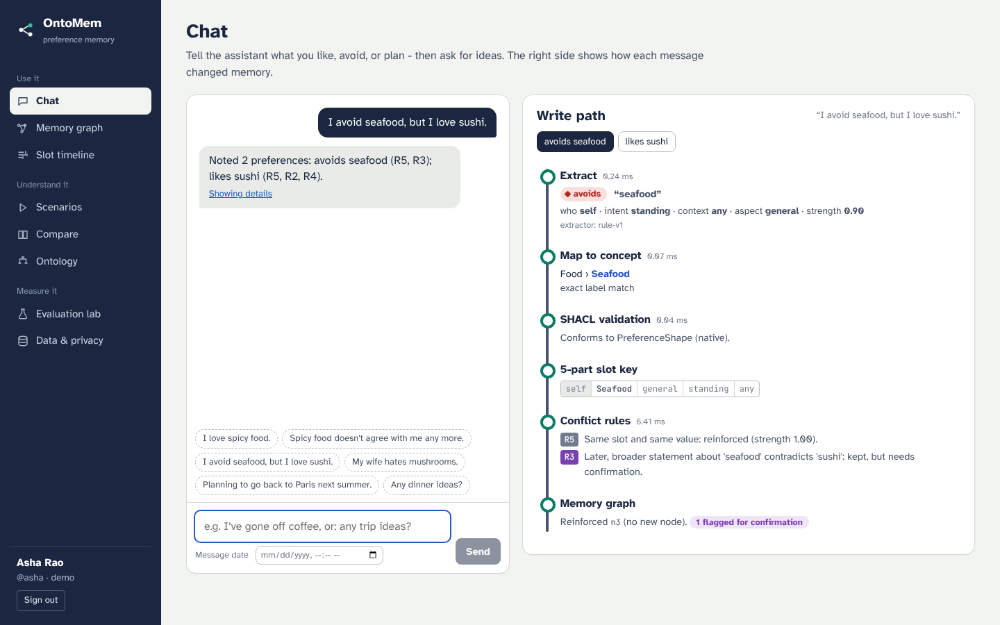

# OntoMem

**Ontology-guided knowledge representation and reasoning for explainable, consistent preference memory in AI agents.**

Final-year project, RV College of Engineering, Centre of Excellence RVCE–BOSTON (AI Research and Business Solutions).
Chetan M Patil · Harshit Raj · Manish H Parashar · Bhavin Bhat. Mentor: Dr. Somesh Nandi.

When a user revises a preference, an assistant's memory must decide **which stored preference the new statement replaces**.
Mem0 and Zep let a language model guess. Deng & Sinchaisri (2026) showed those guesses cause *missed merges* (outdated values
stay active) and *false merges* (valid values are silently erased), and left open whether a richer schema would do better.
OntoMem answers that question: a SKOS concept hierarchy, a 5-part slot key and a small defeasible theory make the decision
deterministically, verifiably and explainably.



## Results at a glance

PrefRev test split: 150 synthetic users, 2,986 statements, 1,506 probes, every gold slot key known. No LLM judges anything.

| System | Missed merges *p* | False merges *q* | Stale exposure | Clean retrieval (95% CI) | Harmful@5 |
|---|---:|---:|---:|---:|---:|
| S0 append-only | 100% | 0.0% | 37.1% | 62.9% (59.6–66.4) | 0.5% |
| S1 rule extractor, surface key | 44.6% | 6.9% | 19.7% | 52.3% (48.7–55.6) | 1.3% |
| S5 learned keyer (no ontology) | 30.2% | 0.9% | 14.1% | 84.6% (82.1–87.1) | 0.5% |
| **S3 OntoMem** | **1.9%** | **0.13%** | **1.3%** | **98.5% (97.4–99.4)** | 0.5% |
| S4 oracle keys | 0% | 0% | 0% | 100% | 0% |

*Gold-extraction setting (isolates the key decision). OntoMem vs every baseline: McNemar, Holm-corrected p < 10⁻⁴⁰.*

- **All remaining OntoMem errors are concept-mapping misses** on unusual paraphrases (14 of 2,986 writes). There are zero keying or rule errors.
- **End-to-end from raw text**, OntoMem reaches 60.8% clean retrieval vs 61.3% for oracle keys given the same extractor (p = 0.12, not significant). Extraction recall, not keying, is the remaining bottleneck.
- **Ablation:** removing *who*, *context* or *intent* from the key costs 14.8, 12.2 and 11.5 points of clean retrieval. Removing the SKOS hierarchy adds 6.6 points of harmful suggestions (dishes the user avoids). Removing rule R3 adds 2.1.
- **SHACL + repair** under 15% malformed extractions: stale exposure falls from 10.6% to 7.2%; all 451 malformed candidates are repaired.
- **Theory:** a closed-form model of stale exposure as a function of *p* and *q* matches simulation within 0.75 points on average.
- **Ontology evolution:** growing the ontology from training conversations raises mapped statements from 89% to 99.8% and halves false merges.
- **Verification:** the Python reasoner and an independent ASP (clingo) encoding agree on 3,000 random histories (42,539 events). The cross-check found one real bug in each implementation during development.
- **Scale:** at 10,000 statements (about 6,400 live slots), write p95 is 0.28 ms and read p95 is 47 ms.

Full numbers: [`results/`](results/) · figures: [`results/figures/`](results/figures/) · method: [`docs/evaluation_protocol.md`](docs/evaluation_protocol.md).

## Quick start

```bash
# 1. install (Python 3.11+)
pip install -e ".[dev]"

# 2. run the API + web app (demo accounts are seeded automatically)
cd frontend && npm install && npm run build && cd ..
ONTOMEM_SECRET=$(python -c "import secrets;print(secrets.token_hex(32))") ontomem serve
# open http://localhost:8000 and click "Continue as Asha Rao"

# 3. or develop with hot reload
make backend          # :8000
make frontend         # :5173 (proxies /api to :8000)
```

**Docker:** `docker compose up --build`. Add `--profile llm` to also start Ollama.

No GPU, no internet and no language model are needed for the demo, the tests or the main experiments.

### Reproduce every number in the report

```bash
make reproduce     # ~2 minutes: ontology -> PrefRev -> validation -> ASP cross-check -> all experiments -> figures
make test          # 77 tests, including property-based invariants (Hypothesis) and Python-vs-ASP differential tests
make gate-g2       # the Week-6 decision gate, on the dev split
```

### Run the LLM baselines (on your machine)

```bash
ollama pull qwen2.5:7b-instruct
export ONTOMEM_LLM=ollama:qwen2.5:7b-instruct
make bench-llm     # S2 (Mem0-style) and S2b (LLM constrained to ontology candidates) vs S3 and S4
```

These runs are fully implemented and tested with scripted model responses. **No LLM numbers are reported in this repository**,
because none could be run where it was built. They must come from your runs.

## What is in the box

| Path | What it is |
|---|---|
| `src/ontomem/core/` | The engine: SKOS ontology, concept mapper, rule extractor, SHACL validation (pyshacl + compiled), 5-part slot key, reasoner (R1–R6), belief model, event log, RDF/SPARQL projection, read path with default logic, token-budget packing, proof trees and counterfactuals |
| `src/ontomem/core/asp/` | The same theory in Answer Set Programming, plus the differential tester |
| `src/ontomem/data/ontology/` | `concepts.ttl` (229 SKOS concepts, 6 domains, 792 labels), `prefs.ttl` (vocabulary), `shapes.ttl` (SHACL) |
| `src/ontomem/prefrev/` | PrefRev benchmark generator (10 case types, held-out templates, coverage split), validator, power analysis |
| `src/ontomem/evaluation/` | Systems S0–S5, metrics, cluster-bootstrap CIs, McNemar/Holm tests, analytic p/q model, ontology evolution, scale, figures |
| `src/ontomem/evolve/` | Ontology evolution: proposals, consistency checks, versioning |
| `src/ontomem/backend/` | FastAPI: JWT auth, tenant isolation, chat (+SSE), memory/graph/timeline, clarifications, compare, ontology review, evaluation lab, SPARQL, SHACL, export/erase, metrics |
| `src/ontomem/sdk/`, `mcp_server/` | Python client and an MCP server (`remember`, `recall`, `explain`, `clarify`, `forget`) so any agent can use OntoMem |
| `frontend/` | React + TypeScript web app (10 screens) |
| `docs/` | Formal semantics, architecture, evaluation protocol & pre-registration, viva FAQ, demo script, threat model, screenshots |
| `results/` | Every experiment's output: `summary.json`, `table.csv`, `table.tex`, `failures.jsonl`, figures |

## The idea in one example

```
March   "I love spicy food."                         -> new slot   self·SpicyFood·general·standing·any = likes
June    "Spicy food doesn't agree with me any more." -> R1         same slot, new value; March retired to history
June    "I avoid seafood, but I love sushi."         -> R2         Sushi ⊏ Seafood: both kept, the specific one wins
July    "No seafood at all for me now."              -> R3         later and broader: sushi kept but flagged; the assistant asks
        "My wife hates mushrooms."                   -> R6         a different subject, a different slot
October "Any dinner ideas?"                          -> read path  vegetable maki, not prawn curry - with the statements that decided it
```

The slides listed `intent = likes`. In OntoMem, **polarity is the value, not part of the key** (design decision D1). Otherwise
"love spicy food" and "spicy food doesn't agree with me" would sit in different slots and the update could never retire the
old value. See [`docs/formal_semantics.md`](docs/formal_semantics.md).

## Honest limits

- PrefRev is synthetic and team-authored. Held-out test templates, a coverage split and paraphrase banks reduce, but cannot remove, the risk that the benchmark suits the method.
- The offline rule extractor misses about 18% of test-split statements, whose phrasings have no cue it knows. That is why the end-to-end numbers are lower for every system.
- LLM-based baselines (S2, S2b) and LLM extraction are implemented but not evaluated here.
- The base paper and several 2026 references post-date the tools used to build this. Metric definitions follow the project slides and are isolated in `evaluation/metrics.py` for checking against the paper.

## License

MIT for the code. PrefRev is generated, not collected, and contains no personal data.
