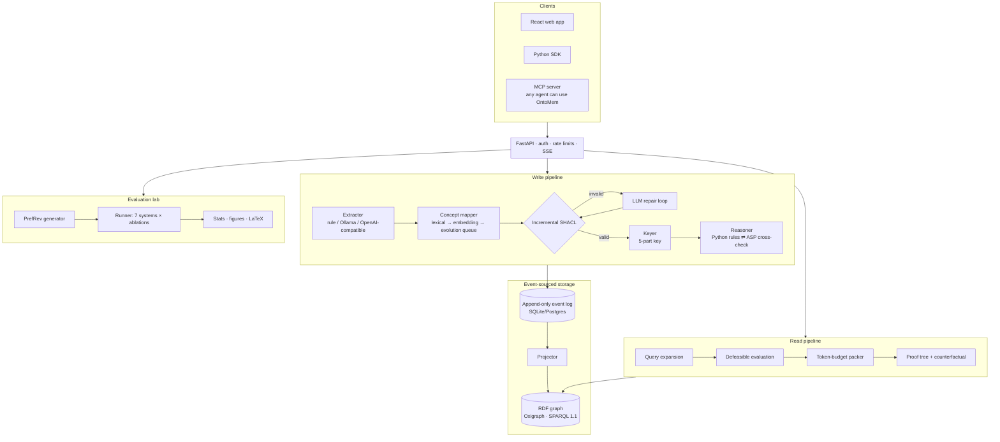

# OntoMem — Build Plan v2 (deeper scope, for approval)

**Project:** Ontology-Guided Knowledge Representation and Reasoning for Explainable, Consistent Graph-Based Personalization
**Team:** Chetan M Patil · Harshit Raj · Manish H Parashar · Bhavin Bhat — RVCE CoE (RVCE–BOSTON), mentor Dr. Somesh Nandi
**Status:** Draft v2, 10 Nov 2026 — supersedes v1. Nothing is built until you approve.

> **Principle for v2:** every addition must answer a research question or a likely viva question. Depth comes from *formal guarantees, stronger baselines, honest evaluation and real systems engineering* — not from extra screens.

---

## 0. What changed from v1

| Area | v1 | v2 |
|---|---|---|
| Research questions | 1 (does ontology keying beat LLM keys?) | **6 RQs**, incl. *is it the ontology or just determinism?* |
| Failure modes covered | Staleness only | **All three from the base paper**: stale, misattributed, late |
| Reasoning | Python if/else rules | **Formal defeasible-logic semantics**, two independent reasoners (Python + ASP/clingo) cross-checked by differential testing, invariants proved and property-tested |
| Belief model | strength number | **Evidence-weighted confidence** with hedging, reinforcement, time decay and AGM-style minimal-change revision |
| Baselines | 5 systems | **7 systems**, incl. ontology-*constrained* LLM and a *trained* key classifier |
| Ontology | Static | **Ontology evolution**: unmapped concepts proposed, consistency-checked, human-approved; coverage growth measured |
| Storage | rdflib in memory | **Event-sourced** architecture: append-only event log → RDF projection (Oxigraph, SPARQL 1.1), deterministic replay, time travel |
| Retrieval | fetch + specificity | SKOS query expansion, **token-budgeted memory packing**, latency SLOs (lateness metric) |
| Explanations | cite source sentence | **Proof trees** from the reasoner + **counterfactual** explanations |
| Agent behaviour | answer | **Clarification dialogue** when beliefs conflict (active belief repair) |
| Evaluation | merge metrics | + downstream **recommendation NDCG**, PERMA answer accuracy, analytic p/q model validated by simulation, power analysis, pre-registration, small **user study** |
| Engineering | FastAPI + React | + multi-user auth & tenant isolation, privacy (export / right-to-be-forgotten), **MCP server + Python SDK** so real agents can use it, CI, load tests, observability |

---

## 1. Research questions and hypotheses (goes into the pre-registration for Gate G3)

| RQ | Question | Hypothesis | Measured by |
|---|---|---|---|
| **RQ1** | Does ontology keying reduce merge errors vs LLM-chosen keys? | H1: S3 has lower false-merge *and* missed-merge rates than S2 | q, p, valid-erasure, stale exposure |
| **RQ2** | Is the gain from the **ontology structure** or merely from **determinism**? | H2: S2b (LLM constrained to ontology candidates) closes most of the gap → structure matters; S5 (trained classifier, no hierarchy) does not | S2 vs S2b vs S3 vs S5 |
| **RQ3** | Which components carry the effect? | H3: removing SKOS hurts exception cases most; removing intent hurts Paris-type cases; removing SHACL raises corrupt writes | ablations, per-case-type breakdown |
| **RQ4** | Does cleaner memory improve what the user actually gets? | H4: lower stale exposure → higher recommendation NDCG@5 and PERMA answer accuracy | downstream metrics |
| **RQ5** | Can the ontology grow without breaking consistency? | H5: evolution raises coverage on the out-of-ontology split with no rise in false merges | coverage curve, q before/after |
| **RQ6** | Does it meet serving deadlines and scale? | H6: p95 read latency < 50 ms at 10k prefs/user; write path < 200 ms excluding LLM | latency, deadline-miss rate, throughput |

---

## 2. Core design (kept from v1, now formalised)

### 2.1 Slot key and value — correction to the slides (D1)
`intent = likes` in the slide example would put "love spicy food" and "spicy food doesn't agree with me" in **different** slots, so the update could never supersede — the exact missed merge the project fixes. So:

- **Key** = `who · what · aspect · intent · context`
  - `who`: person the preference is *about* — `user_7`, `user_7/partner`, `user_7/child` (this is how we attack **misattribution**: "my wife hates mushrooms" must not touch the user's own mushroom slot)
  - `what`: SKOS concept · `aspect`: taste / health / price / ethics / experience · `intent`: standing / past / plan · `context`: any / work / travel / with-kids / …
- **Value** = `polarity ∈ {likes, dislikes, avoids, neutral}` + belief state (§2.3)

### 2.2 Formal semantics of conflict resolution
The rules are specified once, formally, as a **defeasible theory** (Nute-style: strict rules, defeasible rules, a superiority relation), then implemented twice:

| Rule | Formal reading | Action |
|---|---|---|
| R1 Supersede | same key, later `statedAt` ⇒ later defeats earlier | retire old, `supersededBy`, `validTo` |
| R2 Exception | `what₂ ⊑ what₁` (skos:broader⁺), same aspect/intent/context ⇒ specific defeats general **for `what₂` and below only** | keep both, `exceptionTo` |
| R3 Broad override | `what₁ ⊑ what₂`, opposite polarity, later ⇒ *conflict, no defeater* | keep both, `needsConfirmation`, trigger clarification |
| R4 Orthogonal | differ in intent or context ⇒ no attack | coexist |
| R5 Reinforce | same key, same polarity ⇒ evidence update | no new node; belief update |
| R6 Third-party | `who ≠ holder` ⇒ separate subject | never touches holder's slots |

**Two independent implementations:**
1. `rules.py` — fast Python engine used in production.
2. `asp/rules.lp` — the same theory in **Answer Set Programming (clingo)**.

**Differential testing:** thousands of random event sequences (Hypothesis) run through both; any disagreement is a bug in one of them. This is a classic verification technique and a strong viva point: *"how do you know your rules are correct?"*

**Invariants — stated as theorems in the docs and checked by property-based tests:**
- **I1 Key uniqueness:** at most one active node per (key, polarity-class) at any time.
- **I2 No silent loss:** nothing is deleted except by explicit erasure; every retirement has a `supersededBy` and a rule id.
- **I3 Deterministic replay:** replaying the event log in timestamp order always yields an isomorphic graph (order-independent for ties via a total order on event ids).
- **I4 Specificity monotonicity:** adding a narrower exception never changes the stance on concepts outside its subtree.
- **I5 Idempotence:** repeating a statement never creates a new slot.

### 2.3 Belief model (beyond a bare "strength")
- **Hedging** ("I think I might…", "not a big fan") sets initial strength from a calibrated lexicon.
- **Reinforcement** (R5) raises confidence with diminishing returns; **time decay** lowers confidence for long-unconfirmed preferences (half-life per aspect: taste decays slowly, "plan" intents expire after their date).
- Revision follows **AGM minimal change**: a revision retires the fewest nodes that restore consistency. Documented with the AGM postulates our operator satisfies and which it deliberately drops (and why).

### 2.4 Read path
Query → concept mapping + **SKOS query expansion** (broader/narrower/related) → fetch active prefs (indexed) → defeasible evaluation, most-specific wins → **token-budgeted packing** (knapsack over relevance × confidence under a token limit, so the memory block stays small) → memory block + **proof tree** → catalog ranker (+ optional LLM phrasing).

**Counterfactual explanations:** "I'm suggesting tofu stir-fry, not prawn curry, *because* in June you said seafood disagrees with you; without that statement I'd have suggested prawn curry."

**Clarification dialogue:** R3 conflicts and low-confidence beliefs make the agent ask one targeted question ("Does avoiding seafood include sushi?"); the answer is written back as a high-confidence event. We measure how many questions are needed to restore a clean state.

---

## 3. Ontology layer

- **Vocabulary** `pref:` + **PROV-O** for provenance (who said it, which extractor, which model version, which rule).
- **SKOS schemes** for 6 domains, ~400 concepts with prefLabel/altLabel/hiddenLabel (misspellings), `skos:related` for query expansion. Domains: Food & Diet, Travel, Movies & TV, Music, Books, Shopping.
- **SHACL** shapes: node-level (types, ranges, enums) **and graph-level** SPARQL-based constraints (I1 key uniqueness, no supersession cycles, retired ⇒ has successor).
- **Incremental validation:** validate only the focus subgraph of the new node (not the whole graph) — benchmarked against full validation.
- **Ontology evolution (RQ5):** unmapped concept → candidate placements ranked by lexical + embedding similarity (+ LLM proposal when available) → **consistency checks** (no cycles, no label collisions, SHACL on the ontology itself) → human **review queue** in the UI → versioned ontology releases (semver; every memory node records the ontology version it was keyed under; re-keying migration when a concept moves).
- **Optional alignment:** importer for an external taxonomy subset (e.g. Wikidata cuisine/genre classes) to show the ontology can be grounded in public vocabularies.

---

## 4. Architecture



**Why event sourcing:** the log is the source of truth and the graph is a projection, so "memory as of June" is a replay, any bug fix can be replayed over history, and experiments are bit-reproducible. It's also how production systems handle audit requirements.

### Repository layout
```
ontomem/
├── core/          ontology/ (ttl, shapes, versions) · extract/ · mapping/ · keying.py · reasoner/ (rules.py, asp/*.lp, crosscheck.py)
│                  belief.py · events.py · projector.py · store/ (oxigraph, rdflib fallback) · retrieve/ (expand, pack, explain) · recommend.py · evolve/
├── prefrev/       generator · personas · templates (train/test-disjoint) · splits · PERMA importer · validators
├── evaluation/    systems/ (S0–S5) · noise simulator · metrics.py · analytic_model.py · stats.py · power.py · figures/ · preregistration.md
├── backend/       FastAPI app · auth · routers · SSE · jobs · metrics endpoint
├── sdk/           Python client  ·  mcp_server/  (MCP tools: remember, recall, explain, forget)
├── frontend/      React + TS + Vite + Tailwind + Cytoscape.js + Recharts
├── tests/         unit · property-based (Hypothesis) · differential (Python vs ASP) · API · e2e (Playwright) · load (Locust)
├── docs/          architecture · formal semantics · ontology guide · evaluation protocol · threat model · viva FAQ
└── .github/workflows/ci.yml · docker-compose.yml · Makefile
```

---

## 5. PrefRev v2 (benchmark)

- Seeded generator → JSONL episodes with **gold per turn** (key, value, expected rule) and **probes** with gold active set **and** gold recommendation relevance.
- **Case types (10):** replace · exception · broad_override · intent · context · reinforce · hedge · trap (false-merge bait: "spicy thrillers") · third_party (misattribution: "my wife hates…") · coverage (out-of-ontology) · plus noise turns.
- **Difficulty tiers:** explicit ("I no longer eat X") → implicit ("X doesn't agree with me") → indirect ("doctor told me to cut X"), and long gaps (months between statements).
- **Splits:** train / dev / test · held-out templates · coverage split (~15% concepts not in ontology) · multi-person split.
- **Validator:** checks gold labels are internally consistent by running the oracle and asserting all invariants.
- **Power analysis** decides the size needed to detect a 3-point difference in false-merge rate (paired, α = 0.05, power 0.8) — no arbitrary dataset size.
- **PERMA importer** for answer-accuracy evaluation (fetched from GitHub during the build if reachable; otherwise you run it locally).

## 6. Systems compared (retirement rule identical in all)

| # | System | Key assignment | Purpose |
|---|---|---|---|
| S0 | Append-only | none | floor (base paper's 70.3% stale) |
| S1 | Rule flat key | (who, head noun) | base paper's rule extractor |
| S2 | Free LLM (Mem0-style) | LLM picks ADD/UPDATE/DELETE/NOOP vs top-k memories | industry practice |
| S2b | **Ontology-constrained LLM** | LLM must choose concept & key fields from ontology candidates (JSON-schema constrained output) | RQ2: structure vs determinism |
| S3 | **OntoMem (ours)** | deterministic ontology keying + defeasible rules | the contribution |
| S4 | Oracle | gold keys | upper bound |
| S5 | **Learned keyer** | gradient-boosted pairwise "same slot?" classifier trained on PrefRev-train, no hierarchy | RQ2: can supervision replace the ontology? |

**Ablations of S3:** −SKOS · −intent · −context · −SHACL · −R3 · −belief model · −query expansion · −incremental SHACL (cost only).

**p/q noise simulator + analytic model:** derive closed-form expected stale exposure and valid erasure as functions of missed-merge rate *p* and false-merge rate *q*, then confirm the formula against simulation. Reproduces and extends the base paper's sensitivity analysis.

## 7. Metrics and statistics
- **Memory state (no LLM judge):** false-merge q, missed-merge p, valid erasure, stale exposure, clean retrieval, exception accuracy, **misattribution rate**, mapping coverage, error attribution by stage (extraction / mapping / keying / reasoning).
- **Downstream:** recommendation NDCG@5 and stale-suggestion rate on the catalog; PERMA answer accuracy (LLM runs, on your machine).
- **Systems:** write/read latency p50/p95/p99, **deadline-miss rate** (lateness), throughput, LLM calls and tokens per 1k turns, memory-block size in tokens.
- **Stats:** bootstrap 95% CIs, paired McNemar/permutation tests, Holm correction for multiple comparisons, effect sizes. Outputs: CSV, PNG/SVG figures, LaTeX tables.
- **User study (optional, small):** 8–12 classmates use OntoMem vs a baseline variant on scripted tasks; SUS usability score and explanation-helpfulness ratings. I'll build the study mode and consent screen; you run the sessions.

## 8. Backend and integration
- **FastAPI** with JWT auth, per-user tenant isolation (graph named per tenant; isolation tested), rate limiting, OpenAPI docs.
- Routes: chat (SSE pipeline trace) · memory (`as_of`, filters) · graph · explain (proof tree, counterfactual) · clarifications · ontology (tree, search, proposals, review, versions) · eval runs (background worker, progress over SSE) · read-only SPARQL · privacy (export all my data as JSON-LD, erase me) · `/metrics` (Prometheus format) · health.
- **Privacy:** right-to-be-forgotten erases events and projections and leaves a tombstone without content; PII-looking strings are redacted from logs; threat model in docs (prompt injection via user statements, cross-tenant leakage).
- **Python SDK** and **MCP server** exposing `remember`, `recall`, `explain`, `forget` — so OntoMem can be plugged into an actual agent (shows industry relevance beyond our own UI).

## 9. Frontend (React + TypeScript)
1. **Login / user switcher** (multi-user demo, shows tenant isolation)
2. **Chat Playground** — chat + live pipeline inspector per turn; clarification questions appear inline
3. **Memory Graph** — Cytoscape graph, active vs retired, **time-travel slider** (event replay), node provenance panel
4. **Explain view** — interactive **proof tree** and counterfactual for any suggestion
5. **Slot Timeline** — per-key history with rule annotations and confidence curve over time
6. **Compare Mode** — one script through OntoMem and any baseline side by side, divergences highlighted
7. **Ontology Studio** — SKOS tree browser, evolution **review queue** (approve/reject proposed concepts), version diff
8. **Evaluation Lab** — configure and launch runs; system comparison, per-case breakdown, ablations, p/q curves vs analytic model, latency charts; **failure browser** with stage attribution
9. **Privacy Center** — export / erase my data
10. **Scenario Library** — one-click demos: spicy food, seafood/sushi, Paris, broad override, false-merge trap, "my wife hates mushrooms"

## 10. Engineering quality
- **Tests:** unit · property-based invariants (Hypothesis) · differential Python-vs-ASP · API · Playwright end-to-end · Locust load test. Target ≥ 85% coverage on `core/`.
- **CI** (GitHub Actions): lint (ruff), types (mypy strict on core), tests, benchmark smoke run, frontend build.
- **Observability:** structured logs, request tracing ids, Prometheus metrics, an in-app system page.
- **Reproducibility:** `make reproduce` regenerates PrefRev with a fixed seed and rebuilds every figure and table in the report.
- **Docker compose:** backend + frontend + optional Ollama; one command to run.

---

## 11. Build order (all in this session after approval)

| M | Build | Done when |
|---|---|---|
| **M1 Formal core** | ontology + SHACL, event log + projector, keyer, Python reasoner, belief model, rule extractor | invariants I1–I5 pass property tests; demo scenarios correct |
| **M2 Verification** | ASP encoding, differential tester, formal semantics doc | 10k random sequences, zero disagreements |
| **M3 PrefRev v2** | generator, 10 case types, tiers, splits, validator, power analysis | validator passes; size justified |
| **M4 Evaluation lab** | S0–S5 (S2/S2b via Ollama adapters), learned keyer, ablations, analytic p/q model, stats, figures | `make reproduce` builds all tables/figures |
| **M5 Retrieval & explanation** | query expansion, token packer, proof trees, counterfactuals, clarification loop, recommender | read-path latency targets met in benchmark |
| **M6 Ontology evolution** | proposal ranking, consistency checks, versioning, re-keying migration | coverage-split experiment runs |
| **M7 Backend + SDK + MCP** | API, auth, tenancy, privacy, jobs, metrics | API + isolation tests pass |
| **M8 Frontend** | all 10 screens | clicked through in a real browser, screenshots captured |
| **M9 Ship** | CI, Docker, load test, docs, viva FAQ, demo script | fresh clone → running app with one command |

Drafts go to you after M2, M4 and M8 so you can redirect early.

**Fit to your Gantt (Weeks 5–12):** M1–M3 ≈ pipeline + PrefRev + Gate G2 (`make gate-g2`) · M4 + pre-registration file ≈ Gate G3 · M4–M6 ≈ comparison + ablation · M7–M9 ≈ analysis, write-up, release.

---

## 12. Limits, stated up front
- **No LLM runs in my build environment** (no Ollama; model downloads blocked). Everything rule-based, simulated, trained (S5) and formal is real and tested here. S2, S2b, LLM extraction, embeddings and PERMA answer accuracy are fully implemented and tested against recorded responses, but **their numbers must come from your runs**. I won't invent any.
- The base paper and several 2026 references are past my training data; metric formulas live in one file (`evaluation/metrics.py`) for you to check against the paper.
- PrefRev is synthetic and team-authored; the coverage, held-out-template and difficulty splits exist so the report can state how far results generalise.
- Scope risk: this is a large build. If time runs short, the cut order is: user study mode → Wikidata alignment → MCP server → load tests. The research core (M1–M4) is never cut.

## 13. Decisions I need from you
1. **D1** — polarity moves from key to value? *Default: yes.*
2. **Frontend** React + TypeScript? *Default: yes.*
3. **Domains** — 6 broad, or Food + Travel only but deeper (~400 concepts in two domains)? *Default: 6.*
4. **Ollama models** for your machines? *Default: Qwen2.5-7B-Instruct, Llama-3.1-8B-Instruct, nomic-embed-text.*
5. **Storage** — Oxigraph (fast, SPARQL 1.1) with rdflib fallback? *Default: yes.*
6. **Keep or cut**: user study, MCP server, Wikidata alignment? *Default: keep all, cut in that order if needed.*

Reply "approved" (with any changes) and I'll start at M1.
