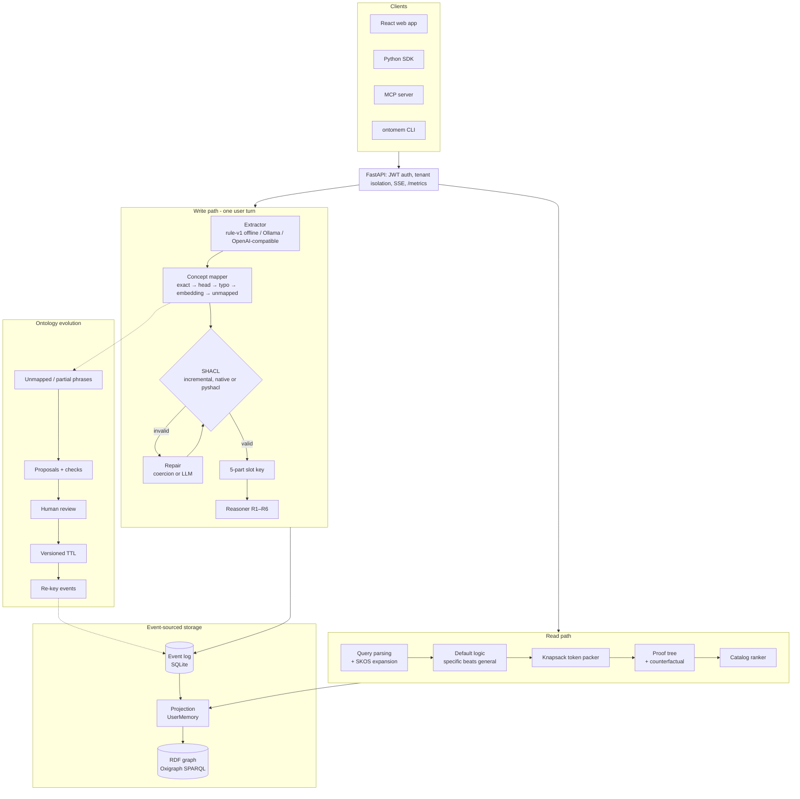

# Architecture

## Key choices

| Choice | Why |
|---|---|
| **Event sourcing** (append-only log → projection) | Time travel is a replay; experiments are bit-reproducible; corrections and ontology re-keying are new events, never edits; erasure is one operation |
| **In-memory projection + RDF on demand** | The reasoner needs microsecond index lookups (writes take 0.02–0.3 ms). RDF/SPARQL/SHACL views are built when asked, so standards compliance costs nothing on the hot path |
| **Two SHACL validators** | pyshacl is the reference (and runs in the API's `/validate` and whole-graph checks). A compiled native validator runs in benchmark loops. A property test asserts they agree |
| **Deterministic core, optional LLM** | Every demo, test and headline number works offline. LLMs plug in at three points: extraction, repair, and phrasing the final reply |
| **State-derived relations (R2/R3)** | Makes replay order-independent and lets every system in the evaluation get identical read-time semantics |
| **Polarity outside the key** | See `formal_semantics.md`, D1 |

## Request lifecycle: `POST /api/chat {"text": "Spicy food doesn't agree with me any more."}`

1. JWT → account id (the tenant). Every memory call is scoped to it.
2. `RuleExtractor` splits clauses, finds the cue "does not agree with me" (object before cue), and yields
   `{surface: "spicy food", polarity: avoids, reason: health, …}`.
3. `ConceptMapper`: exact label → `SpicyFood` (path Food › SpicyFood).
4. `NativeValidator` (the same shape as `shapes.ttl`): conforms.
5. Event `statement` appended to SQLite with the concept and ontology version.
6. `Reasoner.write`: key `self·SpicyFood·general·standing·any` exists with `likes` → **R1**: old node retired (`validTo`, `supersededBy`), new node created.
7. R3 flags recomputed for the node and its narrower active nodes. Clarification questions are derived.
8. The response carries the full `TurnTrace` (each stage's output and timing), which the UI draws as the pipeline rail.

## Module map

| Module | Responsibility |
|---|---|
| `core/model.py` | Enums, `SlotKey`, `Statement`, `PreferenceNode`, `RuleFiring` |
| `core/ontology.py` | Load SKOS, cached transitive closure, lexicon, search, mutation (evolution) |
| `core/mapping.py` | Surface phrase → concept, with the method recorded for error attribution |
| `core/extract/` | Extractor interface, offline rule extractor, deterministic repair |
| `core/llm.py` | Ollama / OpenAI-compatible / record / replay / scripted clients |
| `core/validation.py` | SHACL (pyshacl) and native validators, whole-graph validation |
| `core/reasoner.py` | The write-time theory |
| `core/belief.py` | Strength, reinforcement, decay |
| `core/events.py`, `core/engine.py` | Event log, projection, write and read facades, clarifications, re-keying |
| `core/retrieve.py`, `core/recommend.py` | Default-logic stance, memory-block packing, ranking, proofs, counterfactuals |
| `core/rdf.py` | RDF projection with PROV-O, Oxigraph SPARQL |
| `core/asp/` | ASP encoding + differential tester |
| `evolve/` | Proposals, checks, apply, versioning |
| `prefrev/` | Benchmark generation, validation, power |
| `evaluation/` | Systems, metrics, runner, stats, analytic model, evolution & scale experiments, figures, gate G2 |
| `backend/` | FastAPI app, state, auth, routers, read models |
| `sdk/`, `mcp_server/`, `cli.py` | Integrations |
